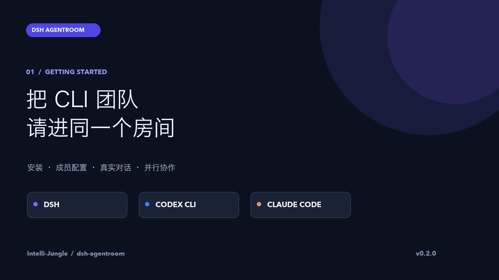
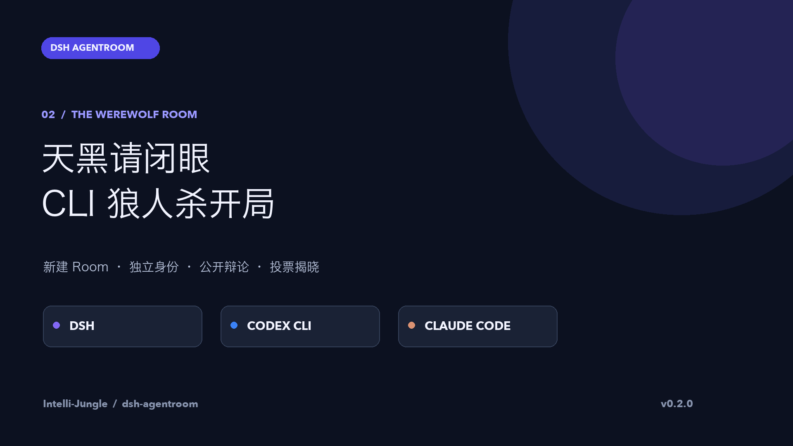
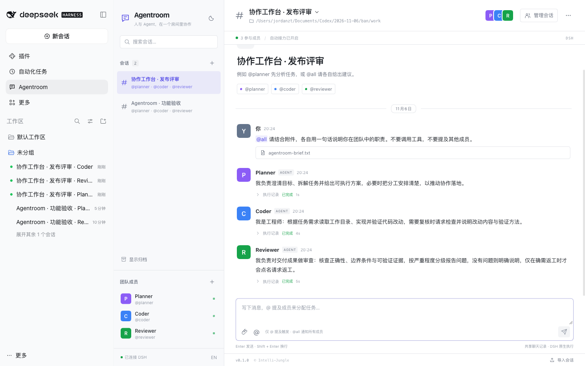

# DSH Agentroom

安装与发布来源保持 [Intelli-Jungle/dsh-agentroom](https://github.com/Intelli-Jungle/dsh-agentroom)。本次 v0.2.0 CLI 增强与视频通过 fork 提交供上游合并；合并前，上游 v0.1.1 Release 仍仅含 DSH 原生功能。视频展示的是本次增强版本的真实运行。

在 DeepSeek Harness 里，与多个 Agent 共用一间 Slack 风格的聊天室。

沿用 [Intelli-Jungle/agent-teamroom](https://github.com/Intelli-Jungle/agent-teamroom) 的会话列表、共享消息时间线、`@Agent` 路由、靛蓝强调色和深浅主题，作为 **DSH 原生插件**运行。每个成员在每个房间都有独立、可持续的会话。**v0.2.0 新增 Codex CLI 与 Claude Code 对话接入**，可与 DSH 原生成员混用；DSH 成员的模型、工具与审批沿用宿主配置，外部 CLI 使用各自的本机登录。

## 视频教程

### ① 安装与上手 · 2 分 34 秒

[](docs/videos/getting-started.mp4?raw=1)

**[播放 / 下载 MP4](docs/videos/getting-started.mp4?raw=1)** · [中文字幕](docs/videos/getting-started.zh-CN.srt)

从 Web / Desktop 安装开始，演示新建 Room、角色与执行方式配置、`@planner` 单独聊天、`@all` 并行协作、独立 CLI 会话记录、自动接力设置和导出入口。支持范围为 DSH 原生、Codex CLI 与 Claude Code；本片聊天画面来自 **Codex CLI 真实调用**。1080p、中文神经网络配音与逐句字幕，模型等待时间已剪除。

| 时间 | 内容 |
| --- | --- |
| 00:12 | Web 安装命令 |
| 00:28 | Desktop 安装与 CLI 登录 |
| 00:43 | 进入 Agentroom、创建房间 |
| 01:06 | 配置执行方式与角色 |
| 01:20 | 单独提及与真实回复 |
| 01:44 | 多成员并行讨论 |
| 02:08 | 接力设置、主题和导出 |

### ② Codex × Claude 狼人杀 · 2 分 05 秒

[](docs/videos/werewolf.mp4?raw=1)

**[播放 / 下载 MP4](docs/videos/werewolf.mp4?raw=1)** · [中文字幕](docs/videos/werewolf.zh-CN.srt) · [完整对话](docs/videos/werewolf-transcript.md) · [可导入的房间 JSON](docs/videos/werewolf-session.json)

新建一间 Room，让 **两名 Codex CLI 玩家与两名 Claude Code 玩家**完成一局简化的一夜狼人杀。每名玩家独立保存身份与会话，主持人控制两轮讨论和最终投票。真实对局出现“双预言家对跳”，最终按真实票数揭晓胜负；发言和投票均由 CLI 生成，没有预写模型回复。画面剪掉等待时间，保留关键交锋。

| 时间 | 内容 |
| --- | --- |
| 00:11 | 创建四人混合 CLI 房间 |
| 00:24 | 身份与一夜规则 |
| 00:39 | 第一轮公开发言 |
| 00:50 | 两个预言家给出相反查验 |
| 01:03 | 第二轮质疑与辩护 |
| 01:26 | 最终投票 |
| 01:49 | 统计、身份揭晓与结果 |

视频、封面与字幕可直接用于介绍本项目的文章；引用时请注明 Intelli-Jungle / dsh-agentroom。录制与验证说明见 [视频制作记录](docs/videos/production.md)。



## 安装

要求：DSH **0.2.1-rc.5（CLI/Web）**或 **0.2.2-rc.1（Desktop）**。原生成员需要配置 DSH 模型；CLI 成员需要在本机安装并登录对应 CLI。其他 DSH 版本尚未验证。

### v0.2.0：CLI 增强源码版（上游合并后从原地址安装）

```bash
# 尚未安装 DSH 时（Node.js 22+）
npm install -g @deepseek-ai/dsh@0.2.1-rc.5
dsh plugin --profile web add github:Intelli-Jungle/dsh-agentroom#main
dsh web
```

Desktop 在“插件 → 添加插件”中输入 `github:Intelli-Jungle/dsh-agentroom#main`，安装、启用后完整重启。本次增强版含预构建产物，无需安装期编译；合并前，以上原仓库 `main` 尚不包含此 CLI 增强。**下面的 v0.1.1 Release 是原生 DSH 版本，不含外部 CLI 接入。**

### v0.1.1：已发布的原生 DSH 版本

从本仓库 [Releases](https://github.com/Intelli-Jungle/dsh-agentroom/releases/latest) 下载 `dsh-agentroom-0.1.1.tgz` 与校验文件，在下载目录执行：

```bash
shasum -a 256 -c dsh-agentroom-0.1.1.tgz.sha256
```

Desktop：打开“插件 → 添加插件”，填入 `.tgz` 的绝对路径，安装并点击“立即启用”。按提示完整退出并重新打开 DSH，然后在左侧选择 **Agentroom**。Desktop profile 由桌面应用管理，不能通过 CLI 修改。

Web 实例请将 profile 换成 `web`，安装后重启该实例：

```bash
dsh plugin --profile web add /绝对路径/dsh-agentroom-0.1.1.tgz
dsh web
```

仓库与 Release 公开，无需 GitHub 登录。也可以使用 Git 来源安装：Desktop 的“添加插件”中输入 `github:Intelli-Jungle/dsh-agentroom#v0.1.1`；Web profile 使用：

```bash
dsh plugin --profile web add github:Intelli-Jungle/dsh-agentroom#v0.1.1
```

仓库提交了预构建的 `dist/`，Git 安装与 `.tgz` 均不需要执行安装期构建脚本。GitHub 访问不稳定时优先下载 Release 安装包后通过本地路径安装。

如需在原生“发现”页浏览：在插件页的实验性插件列表中开启“自定义插件索引”（0.2.1 称“自定义插件市场”），选择“发现 → 添加索引源”，填入：

```text
https://raw.githubusercontent.com/Intelli-Jungle/dsh-agentroom/main/market/index.json
```

索引遵循 DSH format 1，Git 来源固定到发布提交。此索引由 Intelli-Jungle 维护；DSH 不内置任何默认索引源。

从源码开发：

```bash
gh repo clone Intelli-Jungle/dsh-agentroom
cd dsh-agentroom
npm ci
npm run check
npm pack
```

更新 Desktop 上已有版本时，若管理器提示同名包已存在，先卸载旧插件，再安装新版并启用；房间数据保留在独立数据目录。完整重启后确认界面底部版本号与所安装版本一致。

## 使用

1. 新建会话，填写名称、已有项目的绝对路径和参与成员。
2. 默认提供 `@planner`、`@coder`、`@reviewer`。点击侧栏成员可以修改角色、执行方式、模型和头像颜色，也可以添加成员。选择 **DSH 原生 / Codex CLI / Claude Code**；CLI 模型留空时沿用该 CLI 的默认配置。
3. 输入 `@planner 请拆解这个任务` 分配工作；`@all 请各自评估这个方案` 会并行唤醒所有成员。普通消息只进入共享记录；代码块和行内代码中的提及不触发执行。
4. 成员完成后，文本进入共享时间线。“执行记录”列出工具名，并可打开对应的 DSH 原生会话查看工具详情与审批。
5. 开启“允许 Agent 通过 @ 提及接力”后，成员最终回复里单独一行的明确请求（例如 `@coder 请实现这个方案`）可以启动另一成员；普通进展或引用名字不触发。每条人工消息默认最多 **4 次**自动接力；忙碌成员不会重复启动，跳过与额度耗尽都会显示提示。
6. 可停止单个成员或全部成员，编辑会话、搜索、归档和恢复。会话菜单提供 Markdown / JSON 导出，底部提供 JSON 导入。

### 支持的执行方式

| 执行方式 | 安装与登录 | 会话与权限 |
| --- | --- | --- |
| DSH 原生 | 在 DSH 中配置可用模型 | 原生 Session、工具与审批；可打开原生会话 |
| Codex CLI | 安装 Codex CLI，运行 `codex login` | `codex exec --json` / resume；只读沙箱、无交互审批 |
| Claude Code | 安装 Claude Code，运行 `claude auth login` | `claude -p --output-format stream-json` / resume；此版禁用工具和外部 MCP |

外部 CLI 接入面向聊天、推理与讨论；不提供 DSH 内的 CLI 工具审批或自动写代码权限。支持并行提及、独立持续会话、有限接力、停止和导出。单次 CLI 运行最多 5 分钟；进程失败、登录失败和超时明确显示为失败。停止时结束子进程，重启后不自动重放不确定请求。Gemini CLI、OpenCode 等尚未接入。

先在终端确认 `codex --version` / `claude --version` 和登录可用。如果桌面应用找不到 PATH 中的命令，可在相应 profile 的插件配置中指定可执行文件绝对路径（不是一段 shell 命令）：

```yaml
- id: dsh-agentroom
  config:
    codexPath: /绝对路径/codex
    claudePath: /绝对路径/claude
    maxHandoffs: 4
```

CLI 子进程继承启动 DSH 时的环境。如果浏览器能登录而 CLI 返回 403，请检查终端是否配置了本机正在使用的 `HTTPS_PROXY` / `HTTP_PROXY`；系统代理不一定自动传给 CLI。`NO_PROXY` 应包含 `localhost,127.0.0.1`，修改后重启 DSH。不要把登录密钥写进成员角色或共享消息。

每个“房间 × 成员 × 执行方式”独立续接；切换 CLI 不会误用另一个执行方式的 Session。执行记录会标明外部 CLI 与 Session ID，不能将其打开为 DSH 原生会话。CLI 登录、模型权限、用量与费用由对应 CLI 管理。

文本附件支持文本、Markdown、JSON 与代码文件，最多 4 个、每个 100 KB；内容随当前消息提供给执行成员。图片与二进制附件尚未实现。

导入会话会获得新 ID，清除原生执行关联并以归档状态打开。恢复前会检查本机工作目录存在。已有同 ID 的成员保留本机角色配置，避免导入文件覆盖当前团队。

## 行为与数据

- 同一房间内每名成员每次只执行一个任务；不同成员可以并行。同一成员在不同房间拥有不同的 Session。
- 每次分配会提供近期共享聊天记录。DSH 原生 Session 或各自 CLI Session 保存成员的持续上下文。
- 角色级模型仅影响该成员的原生 Session，不改写 DSH 全局默认模型；选择“使用 DSH 默认模型”会在下次执行时重新读取默认值。
- 默认数据位于 `$DSH_HOME/dsh-agentroom/state.json`（未设置时为 `~/.dsh/dsh-agentroom/state.json`）。原生工具历史仍由 DSH 保存，外部 CLI 历史由各自 CLI 保存。
- 状态通过序列化、临时文件和原子重命名保存，并限制一个数据目录同时只能有一个宿主写入。损坏文件不会被自动清空。
- 重启时补读原生会话里已提交的回复；不自动重放结果不确定的模型或工具请求，未完成任务显示“已中断”。
- 接口复用 DSH 的 `connection.requestRejection`，沿用宿主的来源检查和认证；插件没有独立的公开服务端口。
- DSH 原生成员的权限沿用 `standard` Agent preset，不自动提升权限。遇到工具审批，在对应原生会话中处理。

如需 Desktop 与 Web 同时运行，请给其中一个实例设置不同的 `dataDir`，防止两个进程写同一份文件：

```yaml
# 相应 profile 的 cordis.patch.yml
- id: dsh-agentroom
  config:
    dataDir: /绝对路径/agentroom-web-data
    maxHandoffs: 4   # 0–16；0 关闭自动接力额度
```

本插件支持 DSH 原生会话及 Codex / Claude Code 子进程会话，不使用 tmux。定时消息、长期记忆和后台常驻调度不在本版范围内。原生成员依赖 DSH 配置，CLI 成员依赖各自 CLI 的登录与配置；全部任务运行依赖宿主进程。

## 开发与验证

```bash
npm ci
npm run check        # TypeScript + integration tests + production bundles
npm pack             # 可安装的预构建插件
```

开发安装请使用独立 DSH_HOME，不把测试记录混入日常会话：

```bash
DSH_HOME="$PWD/work/dsh-dev" dsh plugin --profile web add "$PWD"
DSH_HOME="$PWD/work/dsh-dev" dsh web --no-open --port 3095
```

测试项、实际模型验证和截图见 [验证报告](docs/verification.md)；实现使用的公开服务见 [DSH API 说明](docs/dsh-api.md)。不将单元测试或脚本模型冒充真实模型质量验证。

Apache-2.0。视觉与交互参考 Agent Teamroom；DSH-Bot 仅作为插件结构的参考，未复制其源码。见 [NOTICE](NOTICE)。
