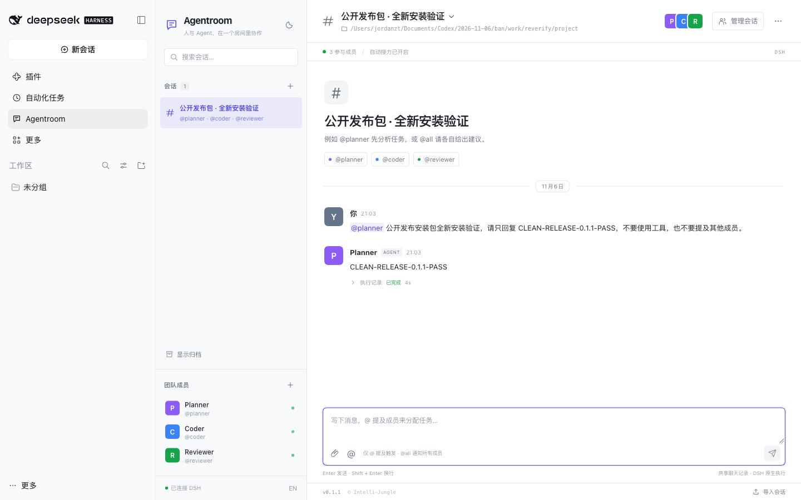
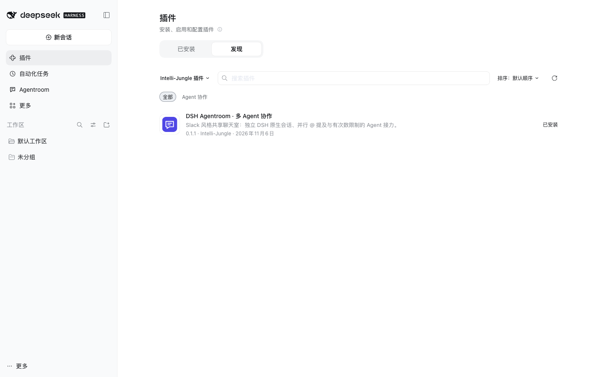

# v0.1.1 发布后复验 · 2026-11-06

公开仓库：[Intelli-Jungle/dsh-agentroom](https://github.com/Intelli-Jungle/dsh-agentroom)。正式版本：[v0.1.1](https://github.com/Intelli-Jungle/dsh-agentroom/releases/tag/v0.1.1)。

## 发布物

- 发布提交：`fd692ff63708e911622bd93ebf5222950136dae3`。
- Release 包：`dsh-agentroom-0.1.1.tgz`；市场稳定文件名：`dsh-agentroom.tgz`。
- 两个文件字节一致，均为 838784 字节，SHA-256：`33bc0bd1ca92979155fbb8bb7bf79b149e1119fbaa6fb25ffec7a7aad3f797d0`。
- 重新通过 GitHub Release API 下载两包与校验文件，分别运行 `shasum -a 256 -c` 均通过。
- 在第二个全新 `DSH_HOME` 从重新下载的正式包安装成功；启动原生 Web、创建房间并发送真实请求，Planner 完成后回复 `CLEAN-RELEASE-0.1.1-PASS`，界面版本为 `v0.1.1`，无浏览器运行错误。



## 功能与升级

发布前第二轮已验证 Coder → Reviewer 的原生 `read` 与自动接力、三个成员的并行真实请求、Web 重启保留记录，以及 Desktop 从旧包替换为 `0.1.1`、启用并完整重启后的数据保留。Desktop 的 Planner 实际回复 `DESKTOP-0.1.1-PASS`。

Desktop 已安装的 Host / Client 文件与发布源码构建的 `dist/` SHA-256 一致。11 项测试、TypeScript 和构建通过；依赖升级为 Zod 4.6.7 后审计零已知告警。完整覆盖范围见 [验证记录](verification.md)。

## DSH 原生发现页

索引地址：<https://raw.githubusercontent.com/Intelli-Jungle/dsh-agentroom/main/market/index.json>。

- 匿名 HTTP 获取返回 200。
- 使用本机 DSH 随附的 `@deepseek-ai/dsh-plugin-market-index` 校验通过。
- 在隔离 Web profile 中通过原生插件界面开启“自定义插件市场”，添加上述真实 HTTPS 地址。
- “发现”页正确显示中文标题、图标、描述、分类、版本 `0.1.1` 与已安装状态；详情页正确显示发布提交 `fd692ff63708e911622bd93ebf5222950136dae3` 和推荐版本。



## CI 与社区投稿

- 发布提交的 [GitHub Actions](https://github.com/Intelli-Jungle/dsh-agentroom/actions/runs/42221961611) 已成功。
- 索引提交的 [GitHub Actions](https://github.com/Intelli-Jungle/dsh-agentroom/actions/runs/42221976586) 已成功。
- 社区收录已提交 [Awesome DSH Plugin PR #12676](https://github.com/awesome-dsh-plugin/awesome-dsh-plugin/pull/12676)，只增加一个 `workflow` 条目文件。条目通过社区的 `validateEntries` 校验，使用 GitHub PNG 与版本无关的 Release tarball 地址。
- 社区要求仓库创建满一天。本仓库创建于 2026-11-06 12:19:08 UTC，因此最早于 **2026-11-07 20:19:08（北京时间）**满足该时间条件。收录与合并仍取决于社区维护者审核；公开 Release 和本项目的原生索引已经可用。

## 本机网络限制

本次环境访问 `github.com:443` 的 Git 源安装与直接 Release URL 出现连接超时，因此没有将 Git 来源安装标记为本机实测通过。`api.github.com` 的 Release 下载和 `raw.githubusercontent.com` 的索引获取正常，正式 tarball 的本地冷安装与运行已通过。需要通过 CLI 下载时，可使用：

```bash
gh release download v0.1.1 --repo Intelli-Jungle/dsh-agentroom --pattern '*.tgz*'
```

本次没有发布 npm 注册表包；DSH 官方允许直接交付预构建 tarball，社区目录也支持该分发方式。
